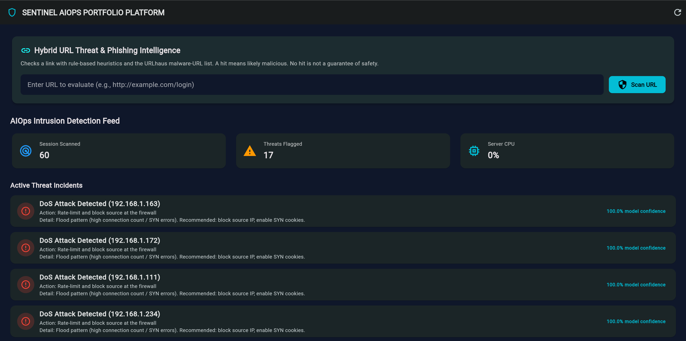
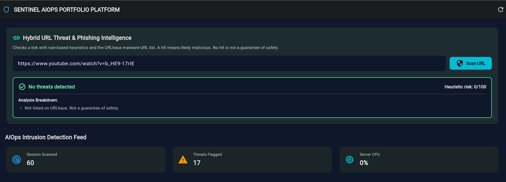
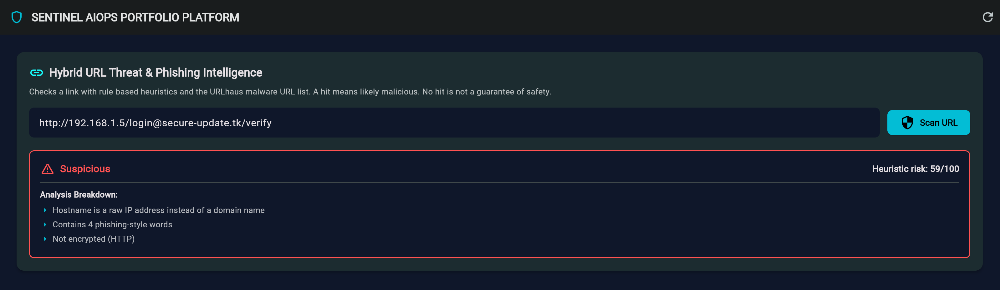
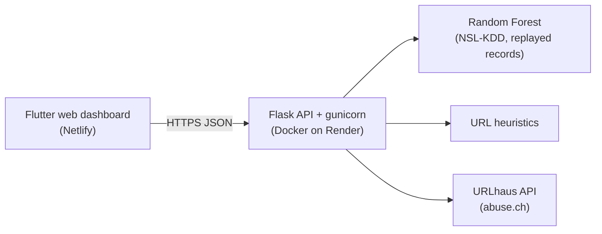

# Sentinel AIOps

A small security dashboard with two parts:

1. **Intrusion alerts.** A Random Forest classifies network-connection records (NSL-KDD) into Normal, DoS, Probe, R2L and U2R, and the dashboard turns each detection into an incident with a recommended response.
2. **Link checker.** Paste a URL and get a verdict from rule-based heuristics plus a lookup in the abuse.ch URLhaus malware-URL list.

It started as a university course project and was then rebuilt as an engineering exercise: training separated from serving, a saved model, tests, CI, Docker, and a live deployment.

**Live demo**

- Dashboard: https://aquamarine-douhua-96e4aa.netlify.app
- API health check: https://sentinel-aiops-0rik.onrender.com/api/health

The backend runs on a free hosting plan that sleeps when idle, so the **first request can take about 50 seconds**. That is the host waking up, not a bug.

| Dashboard | Link scan: no threats found | Link scan: suspicious |
|---|---|---|
|  |  |  |

## What this is, and what it is not

- **Traffic is replayed, not captured.** The alert feed samples records from a 2,000-row slice of the NSL-KDD test set. Nothing here sniffs a real network. Source IPs are simulated, and the "respond" action only updates an in-memory blocklist.
- **NSL-KDD is old (derived from 1999 traffic).** The model is a demonstration of a working pipeline, not a production intrusion detector. See the results below.
- **"No threats detected" is not "safe".** If URLhaus cannot be checked (no key, timeout, error), the verdict is **Unknown**, never clean.
- **The "Server CPU" card** shows the CPU of the machine hosting the API, not of any monitored system.
- **The URL verdict uses no machine learning.** A model was trained and evaluated, but it was not good enough to ship. The reasons are documented below.

## Architecture



## Results

### Intrusion model (NSL-KDD)

Trained on `KDDTrain+`, evaluated on the separate `KDDTest+` set.

| Metric | Value |
|---|---|
| 5-class accuracy | 0.7394 |
| 5-class macro-F1 | 0.4751 |
| Attack-vs-normal recall | 0.5775 |

`KDDTest+` contains attack types that never appear in the training data, so scores are far lower than on a random split, and the model misses a large share of attacks. Per-class precision, recall and the confusion matrix are in [`backend/metrics.json`](backend/metrics.json).

### URL model experiment (PhiUSIIL), not used in the verdict

I trained a Random Forest on 235,370 labelled URLs (after removing duplicates and conflicting labels) and evaluated it with a **domain-grouped split**, where no website appears in both train and test.

| Features | Accuracy | Phishing recall | False-positive rate | ROC AUC |
|---|---|---|---|---|
| Whole URL | 0.955 | 0.914 | 0.006 | 0.995 |
| Hostname only | 0.826 | 0.705 | 0.059 | 0.882 |

The whole-URL numbers look excellent, but a sanity check with ordinary links told a different story: the model scored YouTube, GitHub, Wikipedia and Google links at 0.93 to 0.97 probability of phishing. The cause is a bias in the dataset:

| Share of URLs | Legitimate | Phishing |
|---|---|---|
| With a path or query string | 0% | 28% |
| Using https | 100% | 49% |

Every legitimate URL in the dataset is a bare https home page, so the model learned "has a path, is long, or is not https means phishing". The high score measured that shortcut, not phishing.

A hostname-only version removes that shortcut, but it still wrongly flags about 1 in 17 legitimate sites and appears to penalise sites with subdomains (`en.wikipedia.org` scored 0.66). So the model stays out of the verdict, and the dashboard uses heuristics plus URLhaus, which can be explained and tested. A better dataset, with realistic legitimate links, is the obvious next step.

Reproduce with `python backend/train_url.py` (both result files are in `backend/`).

## API

| Method | Path | Purpose |
|---|---|---|
| GET | `/api/health` | Model loaded? |
| GET | `/api/alerts` | Classify a fresh batch of replayed records, return up to 6 incidents |
| POST | `/api/incidents/<id>/respond` | Mark an incident mitigated and add its (simulated) source IP to the blocklist |
| GET | `/api/blocklist` | Current blocklist |
| GET | `/api/metrics` | Model evaluation metrics |
| GET | `/api/threat-stats` | Training-set attack statistics |
| POST | `/api/scan-url` | Check a link (limited to 20 requests per minute per client) |

```
POST /api/scan-url
{"url": "http://192.168.1.5/login@secure-update.tk/verify"}
```
```json
{
  "url": "http://192.168.1.5/login@secure-update.tk/verify",
  "verdict": "SUSPICIOUS",
  "verdict_label": "Suspicious",
  "is_suspicious": true,
  "risk_score": 59,
  "threat_intel": {"status": "not_listed", "threat": null, "tags": []},
  "reasons": [
    "Hostname is a raw IP address instead of a domain name",
    "Contains 4 phishing-style words",
    "Not encrypted (HTTP)"
  ],
  "features": {"...": "..."}
}
```

Verdicts: `SUSPICIOUS` (listed on URLhaus, or heuristic score of 50 or more), `NO_THREATS_DETECTED` (URLhaus checked and not listed, score below 50), `UNKNOWN` (URLhaus could not be checked).

## Run it locally

**Backend** (Python 3.11)

```
cd backend
pip install -r requirements-dev.txt
python sentinel_bridge.py          # http://127.0.0.1:5000
```

Optional: create `backend/.env` with `URLHAUS_API_KEY=...` (free key from abuse.ch). Without it the link checker still runs heuristics and reports `UNKNOWN` for the URLhaus part.

**Frontend** (Flutter 3.19.5)

```
cd frontend
flutter pub get
flutter run -d chrome --dart-define=API_BASE=http://127.0.0.1:5000
```

**Docker**

```
docker compose up --build          # API on http://localhost:5000
```

**Retrain the models** (datasets are not in the repo)

```
# intrusion model: put KDDTrain+.txt and KDDTest+.txt in backend/
cd backend && python train.py

# URL experiment: put PhiUSIIL_Phishing_URL_Dataset.csv in backend/data/
python backend/train_url.py
```

## Tests and CI

- 53 backend tests (pytest): API behaviour, input validation, rate limiting, CORS, the URL analyzer with URLhaus faked, the schema, and a full training run on small synthetic data.
- 3 Flutter widget tests.
- GitHub Actions runs three jobs on every push: backend tests, Flutter analyze and test, and a Docker job that builds the image, starts it and scans a phishing-style URL.

```
cd backend && python -m pytest tests -q
cd frontend && flutter test
```

## Deployment

- **API:** Docker image deployed on Render (root directory `backend`).
- **Dashboard:** `flutter build web --release --dart-define=API_BASE=<api url>`, uploaded to Netlify manually.

Environment variables for the API:

| Variable | Purpose |
|---|---|
| `URLHAUS_API_KEY` | abuse.ch key for URLhaus lookups. Never commit it. |
| `ALLOWED_ORIGINS` | Exact dashboard origin(s), comma-separated, for CORS. Localhost is always allowed. |
| `TRUST_PROXY` | Set to `1` behind a reverse proxy so rate limits see real client IPs. |
| `PORT` | Listen port (default 5000). |

Security choices: exact-origin CORS, a rate limit on the scanner, input validation, a non-root container, and secrets only in environment variables. The server never opens a submitted URL. It only sends the URL text to URLhaus, a third-party service.

## Project structure

```
backend/    Flask API, training scripts, saved model, tests, Dockerfile
frontend/   Flutter dashboard (web and Windows)
.github/    CI workflow
```

## Limitations and next steps

- Replace NSL-KDD with a more recent flow dataset (for example CIC-IDS2017 or UNSW-NB15) and report how far a model trained on one dataset drops on another.
- Build a URL training set with realistic legitimate links (paths, subdomains) so a model can be trusted in the verdict.
- Add explanations for each alert (for example SHAP values).
- The incident store and blocklist live in memory, so the API runs a single worker. A database would be needed to scale.

## Data and credits

- **NSL-KDD.** Tavallaee, M., Bagheri, E., Lu, W., & Ghorbani, A. A. (2009). *A detailed analysis of the KDD CUP 99 data set.* IEEE Symposium on Computational Intelligence for Security and Defense Applications. Hosted by the University of New Brunswick: https://www.unb.ca/cic/datasets/nsl.html. The file `backend/replay_sample.csv.gz` is a random sample of 2,000 records from `KDDTest+`, included only so the demo can replay traffic. The full dataset is not redistributed here.
- **PhiUSIIL Phishing URL Dataset.** Prasad, A., & Chandra, S. (2024). *PhiUSIIL: A diverse security profile empowered phishing URL detection framework based on similarity index and incremental learning.* Computers & Security. https://doi.org/10.1016/j.cose.2023.103545. Licensed CC BY 4.0. Dataset page: https://archive.ics.uci.edu/dataset/967. Not included in this repository.
- **URLhaus** by abuse.ch: https://urlhaus.abuse.ch/

## License

The code is released under the MIT License (see [LICENSE](LICENSE)). The datasets above keep their own licences and terms.

## Author

Mohosana Maymuna, GitHub [@MohosanaM](https://github.com/MohosanaM)